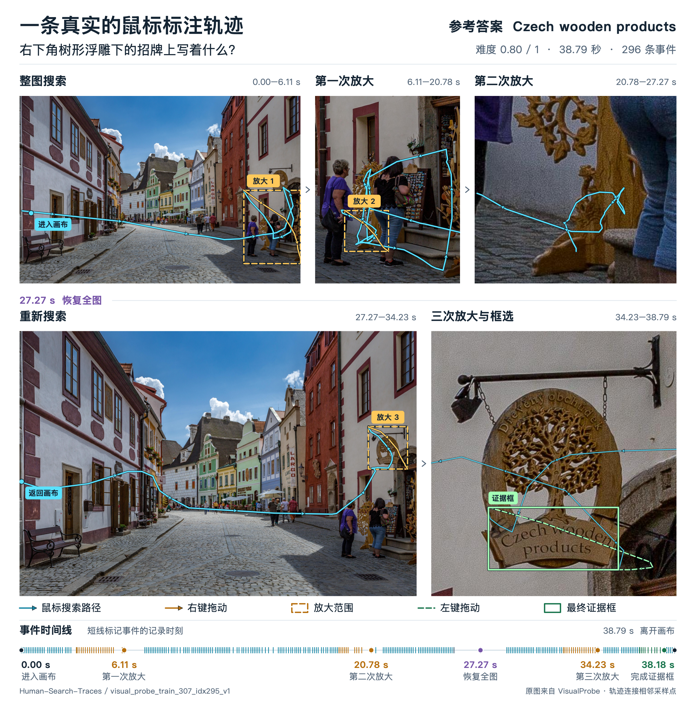

# Marking-Tool

**用于采集人类视觉搜索过程和证据框的桌面标注工具。** 标注员根据问题在原图中搜索、放大局部、标记证据并提交评价；工具保存鼠标交互轨迹、最终证据框、有效标注时长以及难度与置信度评分，可用于视觉语言模型研究和搜索行为分析。



**真实标注示例。** 问题是「右下角树形浮雕下的招牌上写着什么？」标注员先在街边区域搜索、放大两次，在 **27.27 秒恢复全图**，再重新定位木雕招牌，第三次放大后框出文字 **Czech wooden products**。这条记录共 **38.79 秒、296 条事件**，人工难度评分为 **0.80 / 1（hard）**。

青色线连接鼠标搜索的相邻采样点，箭头表示移动方向；黄色表示右键拖动及放大范围，绿色表示左键拖动与最终证据框，底部展示事件时间线。各局部视图按记录中的放大范围从原图裁切。示例会话 `visual_probe_train_307_idx295_v1` 来自 [Human-Search-Traces](https://huggingface.co/datasets/YXNiu/Human-Search-Traces)，原图来自 [VisualProbe_train](https://huggingface.co/datasets/Mini-o3/VisualProbe_train)。

主要功能：

- 完整分辨率原图标注，支持区域放大、多证据框、移动和调整大小。
- **鼠标离开画布，记录和计时一起暂停；返回后继续。**
- **提交前隐藏参考答案，成功提交后显示答案。**
- 支持多数据集，分别保存原图目录、草稿和标注结果。
- 支持 JSON / JSONL 输入、独立会话 JSON 保存和 JSONL 汇总导出。

## 1. 安装与启动

需要 **Python 3.10 或以上版本**，推荐 Python 3.11，以及可运行桌面窗口的环境。

```bash
git clone git@github.com:YXNiu/Marking-Tool.git
cd Marking-Tool
python3 -m venv .venv
```

激活环境：

| 系统 | 命令 |
| --- | --- |
| macOS / Linux | `source .venv/bin/activate` |
| Windows PowerShell | `.venv\Scripts\Activate.ps1` |
| Windows 命令提示符 | `.venv\Scripts\activate.bat` |

安装依赖并启动：

```bash
python -m pip install -r requirements.txt
python main.py
```

之后每次启动，只需激活环境并运行 `python main.py`。macOS 用户配置好 `.venv` 后，也可以双击 `启动标注工具.command`。

### 先用练习题熟悉操作

```bash
python tools/create_demo.py data/demo
python main.py --data data/demo/tasks.json --output output/practice
```

练习图包含红、蓝矩形，可用来试画框、缩放、提交和导出。练习数据与正式标注分开保存；同一个练习目录已经建立后，直接运行第二条命令即可。

## 2. 准备任务文件和原图

建议每个数据集或 split 使用独立目录：

```text
datasets/
├── dataset_a/
│   ├── tasks.jsonl
│   └── images/
│       ├── 001.jpg
│       └── 002.jpg
└── dataset_b/
    ├── tasks.jsonl
    └── images/
        ├── 001.jpg
        └── 002.jpg
```

### 推荐输入：JSONL

**一行一个任务对象**，使用 UTF-8 编码；没有外层方括号，各行之间不加逗号。例如：

```jsonl
{"id":"a_001","image":"images/001.jpg","question":"标牌上的数字是多少？","answer":"30","source_dataset":"dataset_a"}
{"id":"a_002","image":"images/002.jpg","question":"门前的春联共有多少个字？","answer":"14","source_dataset":"dataset_a"}
```

| 字段 | 内容 |
| --- | --- |
| `id` | 任务 ID，建议每题唯一；也支持 `sample_id` |
| `image` | 原图路径，必填 |
| `question` | 给标注员看的问题，必填 |
| `answer` | 参考答案，提交前隐藏；缺失时保存为空字符串 |
| `source_dataset` | 数据来源名称，建议填写，例如 `dataset_a` |

相对图片路径以**任务文件所在目录**为基准。例如上面的 `images/001.jpg` 对应 `dataset_a/images/001.jpg`。如果 `image` 只写了文件名，可以在界面里单独选择原图目录。

还支持 JSON 数组 `[{...}, {...}]`、单条 JSON 对象，以及以下常用输入格式：

| 格式 | 可识别字段 |
| --- | --- |
| VisualProbe | `doc_id / problem / solution / images / data_source` |
| Human-Search-Traces | `sample_id / image / question / answer` 等会话字段 |
| 标准指令任务 | `id / image / instruction` |
| VLM-R1 | `messages / images` |

加载已有会话作为新任务时，其答案、证据框、评分和轨迹不会预先显示。查看已有结果请使用后文的只读检查模式。

## 3. 首次配置数据集

1. 点击 **「选择输出根目录」**，选择所有标注结果统一保存的位置，例如 `annotations`。不选择时，默认使用工具目录下的 `output`。
2. 顶部的数据集名称可留空自动识别，也可在加载前填写便于辨认的名称。
3. 点击 **「加载 JSON / JSONL」**，选择本次数据集的任务文件。
4. 若未找到图片，点击 **「选择原图目录」**，选择该数据集的图片文件夹。
5. 核对左侧的任务 ID、问题、来源，以及右侧显示的原图，开始标注。

原图目录会按数据集分别记忆。切换数据集时，再选择另一份任务文件即可；同名图片和相同任务 ID 的输出也会隔离保存。

也可以用命令行一次指定：

```bash
python main.py \
  --data datasets/dataset_a/tasks.jsonl \
  --images-root datasets/dataset_a/images \
  --output annotations \
  --dataset-name dataset_a
```

## 4. 完整标注步骤

### 第一步：阅读问题

先在左侧阅读问题。将鼠标停在左侧控制面板时，画布记录与计时处于暂停状态。参考答案显示为「提交后显示」。

### 第二步：进入画布搜索

将鼠标移入右侧图像画布，开始或继续记录。初始显示整张原图，没有图像滚动条。

目标较小时，用**右键拖出一个矩形区域**，松开后查看放大的局部；可以继续右键框选进行多级放大。点击「恢复全图」或按 `R` 返回整图。

图像保留原始分辨率。显示适配与局部放大只改变查看方式，所有标注坐标始终对应原图。

### 第三步：标记证据

用**左键拖动**画出回答问题所需的证据框。如果证据分布在多个位置，可以分别画多个框。

| 操作 | 方法 |
| --- | --- |
| 新建证据框 | 左键拖动，任意角都可以作为起点 |
| 在已有框内部再画一个框 | `Shift` + 左键拖动 |
| 选中框 | 左键点击框；选中框为红色 |
| 移动框 | 拖动框内部 |
| 调整大小 | 拖动框的四个角点 |
| 删除选中框 | 点击「删除选中框」，或按 Delete / Backspace |
| 删除全部框 | 点击「清空证据框」并确认；此前的搜索轨迹仍然保留 |
| 取消当前拖动 | 按 Esc |
| 恢复全图 | 点击「恢复全图」，或按 `R` |

请尽量围住完整且与问题相关的证据。操作可以修正，工具会保留修正过程。零面积误点击不会成为最终证据框。未完成的拖动如果越出画布，会取消本次拖动，已经完成的框仍保留。

### 第四步：提交并评价

点击 **「提交并评价」**，或使用 `Ctrl+S`（macOS 为 `⌘+S`），填写两项评分：

| 评分 | 范围 | 含义 |
| --- | --- | --- |
| 搜索 / 定位难度 | 0.00–1.00 | 越大表示越难；默认 0.50 |
| 证据正确性置信度 | 0.00–1.00 | 越大表示越有把握；默认 1.00 |

滑条精度为 0.01，也可以在数值框直接输入。难度等级自动映射为：`≤0.30 easy`、`(0.30,0.60] medium`、`>0.60 hard`。如果问题存在歧义，勾选歧义选项，两项分数保存为 `null`，等级为 `ambiguous`。

**只有成功保存后才会显示参考答案。** 提交成功后当前记录锁定，界面停留本题；评分取消或保存失败时，答案继续隐藏，可以返回标注。

### 第五步：下一题或跳过

点击 **「下一题 / 跳过」** 继续。当前题无需先提交，因此可以跳过暂时不想标的题。未提交内容保留为草稿，不作为完成记录导出。

- 「上一题」返回前一题；`Alt+←` / `Alt+→` 可快捷导航。
- 「跳转到序号 / ID」支持输入题号或任务 ID，界面题号从 **1** 开始。
- 命令行 `--start-index` 从 **0** 开始；也可使用 `--start-id a_001`。

## 5. 记录和计时规则

**时间只在鼠标位于画布内、且会话正在采集时累计。** 画布指右侧图像交互区域，包含随窗口比例产生的留白；左侧问题、按钮和评分控件不属于画布。

| 状态 | 鼠标轨迹 | 计时 |
| --- | --- | --- |
| 鼠标位于画布内 | 记录交互 | 继续累计 |
| 鼠标离开画布 | 暂停 | 暂停 |
| 鼠标返回画布 | 从原记录继续 | 从暂停时刻继续 |
| 评分、切题、关闭后等待恢复 | 暂停 | 暂停 |
| 已提交 / 只读检查 | 不采集新轨迹 | 不再累计 |

例如：在画布内操作 5 秒，移到左侧停留 20 秒，再回到画布操作 3 秒，则累计标注时间为 **8 秒**。重新进入不会清空原轨迹，也不会把离开的 20 秒加进去。画布上方会显示「记录中」「已暂停」或「只读」。

其他记录约定：

- **原点为原图左上角**，x 向右、y 向下；放大后仍使用整张原图的像素坐标。
- 移动事件约每 100 ms 最多记录一次，即约 10 Hz；鼠标静止时不会强制补点。
- 按下、释放、进入、离开、操作开始 / 结束等关键事件即时记录。
- 事件 `t` 使用累计有效时间，单位为毫秒，首次画布事件为 0。
- `annotation_time` 使用最后一个事件的 `t / 1000`，单位为秒，保留两位小数。
- 不记录按钮和评分滑条的鼠标轨迹、点击坐标。恢复全图、删除等结果仍保存相应操作事件；鼠标在画布外触发时，事件使用暂停时刻，时长不增加。

## 6. 保存、恢复和导出

### 自动保存草稿

未提交内容每 5 秒以及切题、退出时保存到本数据集的 `.drafts`。正在拖动时不保存中间草稿；切题或退出会先取消未完成拖动。

重新打开同一份任务文件、使用同一个输出根目录，会恢复原图目录和草稿。已提交题以只读方式显示；未提交题仍隐藏答案。草稿恢复后，鼠标返回画布才继续计时，退出期间不计入时长。

### 输出目录

工具按任务文件自动建立工作文件夹：

```text
annotations/                         # 选择的输出根目录
└── dataset_a--<任务文件标识>/
    ├── workspace.json               # 原图目录、任务来源等本地配置
    ├── sessions/
    │   ├── a_001_idx0_v1.json        # 每次成功提交一个文件
    │   └── a_002_idx1_v1.json
    ├── .drafts/                     # 尚未提交的草稿
    ├── .metadata/                   # 工具版本、原图尺寸等辅助信息
    └── exports/                     # 推荐的汇总导出位置
```

文件名中的 `idx` 是源任务的零基索引，`v` 是会话版本。已有文件不会覆盖；需要生成新版本时，版本号递增。

**开始标注后尽量固定任务文件的位置和内容。** 修改、移动或重命名任务文件会建立新的工作文件夹，旧结果仍保留。切换输出根目录也不会自动搬迁旧数据。备份时请保留整个输出根目录、任务文件和原图。

### 导出 JSONL

点击 **「导出当前数据集 JSONL」**，选择保存位置。导出只包含 `sessions` 中的已提交记录，不包含草稿和本地配置。目标文件已经存在时，请另选文件名。

命令行导出方式如下，使用实际的数据集目录替换示例路径：

```bash
python tools/export_jsonl.py \
  "annotations/dataset_a--<任务文件标识>/sessions" \
  "annotations/dataset_a--<任务文件标识>/exports/sessions.jsonl"
```

默认保留所有独立会话版本。确实只需要同一任务的最高版本时，可加 `--latest-only`。

输出每条会话包含 `id`、`sample_id`、`image`、`question`、`answer`、`final_bboxes_pixels`、`events`、`annotation_time`、`task_evaluation`、`source_format`、`source_dataset`，完整说明见 [数据格式与事件定义](docs/data_contract.md)。

## 7. 查看和检查已有结果

只读查看最终框、参考答案和会话统计：

```bash
python main.py --review \
  --data path/to/sessions.jsonl \
  --images-root path/to/images
```

只读模式允许查看局部和恢复全图，不采集新事件。它展示最终结果，不是逐帧轨迹播放器。

检查数据格式、时间顺序和框的基本有效性：

```bash
python tools/audit_traces.py path/to/sessions.jsonl --output path/to/audit.json
```

## 8. VisualProbe 数据准备示例

如果使用 VisualProbe，可以通过官方 Hugging Face 仓库获取任务，并按任务下载对应原图：

```bash
python -m pip install -r requirements-download.txt
hf download Mini-o3/VisualProbe_train train.json \
  --repo-type dataset --local-dir ../VisualProbe_train
python tools/download_images.py ../VisualProbe_train/train.json ../VisualProbe_images --limit 2
python main.py --data ../VisualProbe_train/train.json \
  --images-root ../VisualProbe_images/data --output annotations
```

`--limit 2` 用于先试前两题；去掉该参数即可下载任务文件涉及的全部原图。`--list-only` 只列清单。图像下载支持缓存，完整图集可能占用数 GB。

[Human-Search-Traces](https://huggingface.co/datasets/YXNiu/Human-Search-Traces) 会话文件也可直接加载，但其中不包含图片，仍需准备对应的 VisualProbe 原图。其他数据集按第 2 节整理任务和图片即可。

## 9. 注意事项与常见问题

| 情况 | 处理方式 |
| --- | --- |
| 提示找不到图片 | 核对 `image` 路径，或重新选择该数据集的原图目录；缺图题不能提交，但可以跳过 |
| 切换数据集后出现同名图片 | 为新数据集单独选择原图目录；工具不会继承前一个数据集的目录 |
| 加载失败并提示某一行 JSON 错误 | 检查该行是否是完整对象；JSONL 的行与行之间不要写逗号 |
| 评分取消或保存失败 | 当前题保留、答案隐藏；检查输出目录权限 / 磁盘空间后重试 |
| 回来后没有看到原草稿 | 核对任务文件路径、内容、数据集名称和输出根目录是否与之前一致 |
| 导出目标已存在 | 换一个导出文件名，原 sessions 文件保留 |
| 需要暂停阅读、休息或操作控件 | 把鼠标移出画布；返回后继续，不额外计入离开时间 |

正式采集前建议先完成一题练习，确认原图、输出目录和评分步骤。采集过程中按实际搜索过程操作，先完成证据标注再提交查看答案；练习结果应与正式结果分开。

## 10. 更多说明与开发测试

- [多数据集统一操作手册](docs/workflow.md)
- [数据格式、坐标、时间与事件定义](docs/data_contract.md)
- [验证记录](docs/validation.md)
- [变更说明](CHANGELOG.md)

```bash
python -m pip install -r requirements-dev.txt
QT_QPA_PLATFORM=offscreen python -m pytest -q
```

图像、任务和标注结果均在本地处理，工具不会自动上传采集内容。使用外部数据集时，请遵循对应数据集的授权条件。
